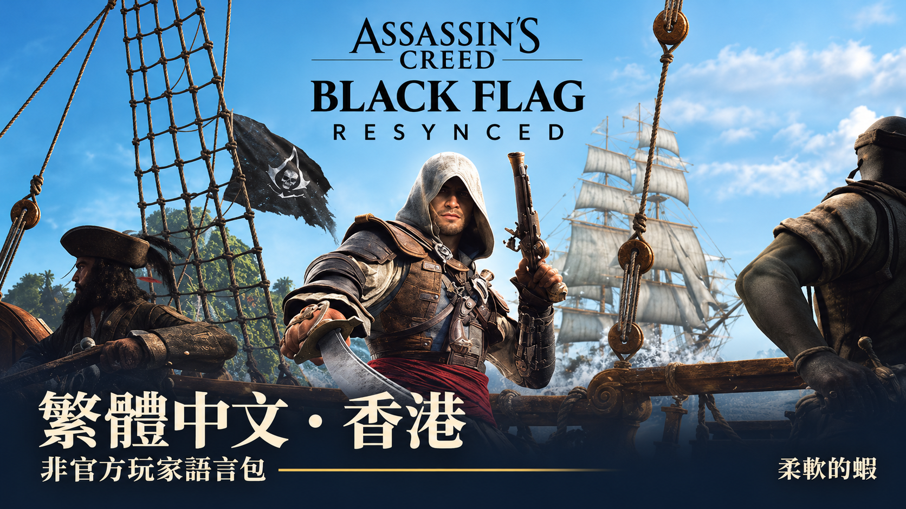

# Black Flag Resynced 繁中香港包

作者：**柔軟的蝦** · 語言：香港繁體中文 · 版本：**2026.11.11-rc2**

本包調整遊戲原有繁體中文文字，採用香港用語及自然對白。20,873 條來源均有既有審校記錄；本版回寫 11,800 條修訂（介面 3,209、對白 8,591）。93 條沒有已驗證繁中目標鍵的建議譯文未加入遊戲。

本次接收 349 段上游新稿，已全部對照英文，調整其中 93 段，並保留上版已確認的修正及統一重複位置。本版較 RC1 更新 363 個遊戲文字目標。

## 測試版下載

[前往 2026.11.11-rc2 測試版發佈頁](https://github.com/softshrimp/ac-black-flag-resynced-zh-hk/releases/tag/v2026.11.11-rc2) · [下載安裝 ZIP](https://github.com/softshrimp/ac-black-flag-resynced-zh-hk/releases/download/v2026.11.11-rc2/ACBF-zhHK-2026.11.11-rc2.zip) · [校驗碼](https://github.com/softshrimp/ac-black-flag-resynced-zh-hk/releases/download/v2026.11.11-rc2/ACBF-zhHK-2026.11.11-rc2-SHA256SUMS.txt)

本版先以 **Pre-release／測試版** 發佈，RC2 的實機遊玩驗收仍待記錄。原創程式碼依作者決定保留所有權利，未指定再利用授權，詳見 [RIGHTS.md](RIGHTS.md)。

## 修正例子：英中語義、港式用語及譯名

以下 **60 個英中語義修正／補足例子**，均以遊戲資源抽取的原繁中，對照目前已發布的 RC2 文字。例子涵蓋詞義、慣用語、邏輯、時序及資訊補足；並非把所有風格差異都定性為錯譯。本文沒有把未發布的 Gemini 草稿當作原遊戲譯文。

為方便閱讀，表格移除了不可見斷詞符及演出／語言標記；其餘譯文沿用實際資源，沒有為展示另寫一套「修正版」。**含劇情及粗口。** 原有技術 QA 通過不等於全庫已無語義問題，仍待修正項目見 [已知問題](KNOWN_ISSUES.md)。

<strong>展開：60 個英中語義修正／補足例子</strong>

| # | 英文 | 原遊戲繁中 | RC2 香港繁中 | 修正重點 |
| ---: | --- | --- | --- | --- |
| 1 | Captain Thatch, as I live and breathe. And what is this magnificent Muzzle you've cultivated? | 薩奇船長，我也跟你呼吸一樣的空氣，但為何你說話時的氣勢如此雄渾呢？ | 薩奇船長，真沒想到會見到你。你留的這把大鬍子可真氣派！ | as I live and breathe 是驚訝認出對方；Muzzle 在此指鬍子，不是同呼吸或說話氣勢。 |
| 2 | You could have been a Man who stood for something. But you've a Killer's Heart now. With nothing but Mettle to show for all your Blunders. | 你或許曾是個服膺真理的人，但現在你只是個殺手而已。除了有勇氣犯錯之外，你什麼都沒有。 | 你本可以成為有信念的人。但如今你只有一顆殺手的心。犯下種種錯誤後，除了逞勇，你還有甚麼？ | stood for something 指有信念；不是斷言曾服膺真理，也不是有勇氣去犯錯。 |
| 3 | I drink Damnation to you and your Men, who are cowardly Puppies! I shall give nor take no Quarter. | 我喝下這毒咒之酒詛咒你們這些懦弱的小狗，我永遠都不會給予或接受敵人的寬恕。 | 我舉杯詛咒你和你那些懦弱的走狗！我不會饒人，也不會求饒！ | drink damnation 是舉杯詛咒，不是喝下一種「毒咒之酒」；quarter 在戰鬥中指饒命。 |
| 4 | Here's how it goes. Torres meets with Prins carrying a Portion of the Ransom, saying the rest is close behind. | 計畫是這樣的：托勒斯會跟普林斯見面，先給他一部分的賞金，騙他說剩下的錢隨後就到。 | 計劃是這樣：托利斯帶著部分贖金見普林斯，聲稱尾數隨後就到 | ransom 是贖金，不是賞金；原句亦沒有明說已先交款。 |
| 5 | Guns and Steel answer louder than Sticks and spittle, Vane! | 槍砲永遠比口水和棍棒還強，范恩！ | 槍炮刀劍比棍棒和口水管用得多，范恩！ | Steel 在兵器語境指刀劍；補回與槍炮並列的兵器。 |
| 6 | What do you make of this Pardon, Edward? Will Nassau survive it? | 愛德華，你覺得那個「赦免」如何？拿索會保存下來嗎？ | 愛德華，你怎樣看這次赦免？拿騷能撐過去嗎？ | survive the pardon 問拿騷能否撐過赦免帶來的衝擊，不是保存物件。 |
| 7 | I've more than enough of all that! | 對付你們全部我綽綽有餘！ | 那些我已經受夠了！ | have had enough 表示受夠了，並非有足夠能力對付所有人。 |
| 8 | Welcome aboard, Duncan. She's a modest Schooner but well-suited to my Purpose. Trafficking Cargo from my Plantation and such. | 歡迎上船，鄧肯先生。雖然這是艘小巧的縱帆船，但卻五臟俱全，能夠協助我順利完成各種海運目標，尤其是從我的農場非法走私。 | 歡迎上船，鄧肯。這艘縱帆船雖小，倒很合用，正好運送我種植園的貨物之類 | 此處談運送種植園貨物；新版不把未明示的非法走私寫成確定事實。 |
| 9 | A damn Sight better than you have, Ben. The Heart of a Traitor, who thinks himself better than his Mates! | 至少我比你有該死的遠見，你只是個叛徒，覺得自己比同伴還重要的叛徒！ | 比你好得多了，班。你一顆叛徒的心，還自以為比同伴高尚！ | a damn sight better 是「好得多」，sight 不是遠見。 |
| 10 | Devil damn the Man, he was fierce. But his Heart was divided. | 魔鬼把他帶走了，他曾是個真正的海盜。最後卻三心二意。 | 該死，他確實兇猛。只是內心始終有所掙扎 | Devil damn 是咒罵，不是魔鬼已把某人帶走；fierce 指兇猛。 |
| 11 | Good! Take us in close. | 好！把船開過去吧。 | 好！把船駛近一點 | in close 是把船駛近，補回靠近的具體操作。 |
| 12 | I did a decent Trick at the Helm some time ago. Two Years before the Mast as a Privateer. | 我之前曾經花時間鑽研掌舵的技巧。就在我成為走私者的前 2 年。 | 我以前也掌過一陣子舵。在私掠船上當過兩年水手 | before the mast 指當普通水手，不是「成為某人之前」；privateer 也不是走私者。 |
| 13 | No Preshah, eh Kenway? The Obeah (black magic) comes natural to us. | 放輕鬆點，肯威！遇到黑魔法不過是家常便飯。 | 不用緊張，肯威。施黑魔法是我們的天賦 | comes natural to us 指施展起來是天賦，不是經常遇到黑魔法。 |
| 14 | Supper. Eat it fast. | （吃快點！） | （晚餐。快吃） | 補回 Supper「晚餐」，不只留下催促快吃。 |
| 15 | Putting some Shape to your Sentiments? | 是什麼不可說的過去嗎？ | 在把心裏的感受寫下來嗎？ | sentiments 是感受；把感受寫成文字，與不可說的過去不同。 |
| 16 | What you feel is the light of Life. Of living Things Past and Present. The Residue of Vitality, come and gone. | 你感受到的是生命之光，只有生命才能留下這樣的印記，像是生命的殘餘物一樣，來去匆匆。 | 你感受到的是生命之光，來自古往今來的生物，那是生命力流轉消逝後留下的痕跡 | Past and Present 修飾生物的時間範圍；不是把生命描述為來去匆匆。 |
| 17 | We’ve knocked them on the Heads except three or four. Let's jump aboard and cut 'em to Pieces! | 無論來了多少敵人，我們都會敲碎他們的腦袋，讓我們跳上敵船，把敵人碎屍萬段！ | 我們已經把他們打倒，只剩三四個！跳上船，把他們砍成碎片！ | 原句是已打倒大部分敵人，只餘三四個；不是不論敵人有多少。 |
| 18 | Devil in his Hole, Thatch! This is a darling Galley. Thirty-two Guns, is it? | 萬事具備了，薩奇！這是艘很棒的帆船，船上總共有 32 把槍，對嗎？ | 真見鬼，薩奇！這船可真漂亮。有三十二門炮，對吧？ | 軍艦搭載的 Guns 是炮，不是三十二把手持槍械。 |
| 19 | Are you not loved at Home? Are you not wanted by your Wives and Families and Countrymen? | 你在家鄉不受歡迎嗎？你被老婆、家人還有鄰居厭惡嗎？ | 家鄉沒有人愛你們嗎？妻子、家人和同胞，都不盼你們回去嗎？ | wanted by family 是家人盼望其回去，不是被家人厭惡；countrymen 是同胞。 |
| 20 | We'll save the clashing of Cutlasses for the Military, and them that get in our way. | 我們這樣就省得拿彎刀跟軍隊，還有那些妨礙我們的人起衝突了。 | 刀劍相向，就留給軍隊和那些擋我們路的人吧 | save ... for 是把刀劍衝突留給特定對象，不是省去與他們交戰。 |
| 21 | You absurd Cutthroats and your precious Philosophy. You live in the World, but you cannot make it move. | 你這做作的愚蠢殺手，你無法改變這個世界的。 | 你們這些荒唐的殺人賊，還有你們那套寶貝哲學。你們活在世上，卻無法推動世界 | 補回對「寶貝哲學」的嘲諷及「活在世上」與「推動世界」的對比。 |
| 22 | True. And yet, three Years ago he sent Men to capture and kill everyone here. Now he's coddling us. It's a Retreat. | 是沒錯，可是 3 年前他還迫不及待想派人滅了所有人，現在卻想招募我們，一定有哪裡出了問題。 | 沒錯。可是三年前，他還派人來抓捕、殺光這裏所有人。如今卻對我們百般遷就。這就是退讓 | Retreat 在此是退讓，不是籠統的「出了問題」。 |
| 23 | Yet another dire Situation, Roberts. We really must stop meeting like this. | 真的有緊急狀況了，羅伯茲，我們真的不該再敵視彼此。 | 又是這樣的險境，羅拔茨。我們真不能老是這樣見面 | stop meeting like this 是不要老在險境中碰面，不是不要再敵視彼此。 |
| 24 | Here's to our Pirate Republic, Lads. We're prosperous and free, and out of the Reach of Kings, Clergy, and Debt Collectors. | 這裡就是我們的海盜共和國，兄弟們。這裡代表著繁榮與自由，而且遠離我們的國王、僧侶還有放高利貸的傢伙。 | 為我們的海盜共和國乾杯，弟兄們。我們富足自由，國王、教士和收債人都管不了我們 | Here’s to 是祝酒；Clergy、Debt Collectors 分別是教士、收債人，不必是僧侶或高利貸者。 |
| 25 | If you are so inclined you may Steer her yourself. My Helmsman and Quartermaster were among those killed. | 如果你這麼看得起她，或許你能考慮掌舵看看，我的舵手跟大副都死在剛剛那場混亂裡了。 | 你有興趣的話，可以親自掌舵。我的舵手和大副都遇難了 | if inclined 是有意或有興趣，不是看得起那艘船。 |
| 26 | No, Kenway. You run this Scheme alone, at the Risk of losing the Faith of your Crew. It makes me ill to think of you bartering with that wretched Slaver. | 不，肯威，你自己去幹，這可能會讓你的船員失去對自由的信仰，你現在談的可是去跟一個奴隸販子斡旋。 | 不，肯威。這計劃你自己去辦，冒著失去船員信任的風險。我一想到你要跟那卑鄙奴隸販子交易，就覺得噁心 | losing the Faith of your Crew 是失去船員對自己的信任，不是讓他們失去自由信仰。 |
| 27 | Yes... Yes, Blackbeard cut me loose sadly. Time to have a Go at this myself. | 是……是的，黑鬍子沒有同意我加入，或許我也該自己嘗試看看。 | 是……是啊，可惜黑鬍子把我打發走了。該自己闖一闖了 | cut me loose 指結束原有關係、打發離開，不是從未獲准加入。 |
| 28 | Oy! Why the long Face? You falling in Love? | 喔！幹嘛盯著我看？你愛上我了嗎？ | 喂！怎麼愁眉苦臉的？墮入愛河了嗎？ | long face 是愁眉苦臉，不是盯着某人看。 |
| 29 | How else to explain your Government's complete Disinterest in your Well-Being? Hostages for Medicines, these were my only Terms! | 不然要怎麼解釋你的政府完全不關心你的安危？我只是要用你來換取一些藥品罷了。 | 否則怎解釋你們政府對你們死活不聞不問？用人質換藥，這是我唯一的條件！ | 談的是以人質換藥的條件，不能縮成只用眼前一個人交換。 |
| 30 | This Billy-Huff didn't last two Months with your Ship before he came limping back to Nassau. Took the Pardon straight away. | 這白癡沒撐多久就把船開回拿索，然後直接哀求他們赦免自己。 | 這吹牛的傢伙，拿了你的船不到兩個月，就狼狽地回了拿騷，馬上接受了赦免 | 補回不到兩個月；took the pardon 是接受赦免，不是哀求對方赦免。 |
| 31 | Oh, Piss! I'll be hanged before I surrender to that Bobbin. | 喔，去死吧！在我投降之前我大概就會先被吊死了。 | 去他的！我寧願被吊死，也不向那傢伙投降 | I’ll be hanged before ... 表示寧死不降，不是預測投降前會先被處刑。 |
| 32 | I can pilot her myself. No mind. | 我能幫你開船，不用擔心。 | 我自己掌舵就行。不用在意 | pilot her myself 是自己掌舵，不是替對方開船。 |
| 33 | Nothing 'round this Spot, sadly. But there's a few Wrecks yonder that haven't been scoured by nothing but Crabs and Coral. | 這附近沒有，但那邊還有一些還沒被沖蝕掉的船艙殘骸，可以去那邊碰碰運氣。 | 可惜這附近沒有。不過那邊有幾艘沉船，除了螃蟹和珊瑚，還沒有人光顧過 | scoured 在尋寶語境指搜尋搜掠，不是殘骸被海水沖蝕。 |
| 34 | I must say, I am quite taken by this new Vocation of mine. And it may amuse you to know that I have authored my own Articles of Conduct. | 我必須得說，我已經開始接受我的新職業了。或許你會覺得可笑，但我已經想好了屬於我的行為準則。 | 說實話，我真喜歡這份新營生。還有件事你定覺得有趣：我親筆擬了一套行為準則 | taken by 表示喜歡、着迷，不只勉強接受；authored 是已親筆寫成。 |
| 35 | Ah, Man... you flatter me with your Persistence. | 喔天啊……你們都讓我為自己感到驕傲了。 | 哎，朋友……你這樣鍥而不捨，真讓我受寵若驚 | flatter me with your persistence 是對方堅持令自己受寵若驚，不是為自己感到驕傲。 |
| 36 | But It's my mandate to fuck with you, Charles. Lads! | 但我就是來惹你的，查爾斯。給我上！ | 可是惹你就是我的職責，查理斯。弟兄們！ | Lads 是呼喚弟兄們，並不是「給我上」的進攻命令。 |
| 37 | A very generous Retreat. | 絕對是大有問題。 | 真是相當慷慨的退讓 | Retreat 是退讓，原譯的「大有問題」沒有保留這個判斷。 |
| 38 | Aye. But in any case, I can't see any our of Men accepting it. | 沒錯，但不管怎樣，我也不希望我們的人接受這個條件。 | 是啊。但無論如何，我不認為我們的人會接受 | can’t see ... accepting 是不認為對方會接受，並非自己不希望他們接受。 |
| 39 | For we intend to take all that you own. Yet no Harm shall befall any Man, so long as he remains at Ease. Is that clear? | 我們打算拿走你們船上的貨物，如果你們能夠冷靜看待這件事，就不會有人受傷，懂了嗎？ | 我們要拿走你們所有財物。不過，只要各位安分守己，就沒有人會受傷。明白嗎？ | all that you own 是所有財物，不僅是船上貨物。 |
| 40 | I take Pride in Piloting my own Ships, Ben. Keeps me alert. | 我喜歡開自己的船，班。我能警戒海面的狀況。 | 我以親自掌船為傲，班。這讓我保持警覺 | keeps me alert 是令自己保持警覺，不限於監視海面。 |
| 41 | Is this some Form of protestant Piety I am not familiar with? | 為什麼突然講起這個？ | 這是某種我不懂的新教虔誠表現嗎？ | 補回新教及虔誠表現這項宗教文化指涉，而非換成泛問為何談起此事。 |
| 42 | But we've all got a Hunger and Passion for the Life we lead here. Once Men taste the Freedom found in our Republic, they'll want no other Flavour. | 不過我們領導著人們順從他們的渴望與熱情，一旦人們嚐到拿索給他們的自由滋味，他們就不會想再受到束縛。 | 但我們都熱愛、渴求這般生活。一旦嚐過共和國的自由滋味，就再也不想要別的了 | the life we lead 是我們過的生活；lead 在此不是領導其他人。 |
| 43 | Captain... we've searched the Hold. It's a middling Take, but the Medicine we found bears a "Charles-Towne" Stamp. | 船長，我們已經搜過了，這艘船只有一些補給品，但藥品上面都貼著「查爾斯城」的標籤。 | 船長，貨艙搜過了，收成一般；不過搜到的藥物上，蓋有「查理斯鎮」的印記 | middling take 指收穫一般，不是只有補給品；補回貨艙及藥物印記。 |
| 44 | Dead and buried. After he tried to kill me. | 死了，我埋了他，他那時候打算宰了我。 | 死了，已經下葬。就在他企圖殺我之後 | After 是在對方企圖殺人之後，原譯「那時候」模糊了先後關係。 |
| 45 | Sir, I had nothing to do with this Attack. My Crew and I had merely anchored to water and resupply! | 閣下，我對這些騷亂一無所知，我與我的船員只是在這裡補給必需品而已。 | 閣下，我與這場襲擊無關。我和船員只是在此拋錨，補充飲水和物資！ | nothing to do with 是沒有參與或牽涉，不是完全不知道發生了甚麼。 |
| 46 | Don't kill me, Sir! I have a Family. Please! | （別殺我，拜託！我還有老婆孩子要養呢！） | （先生，別殺我！我還有家人。求求你！） | family 只說家人，不自行補上老婆、孩子及扶養責任。 |
| 47 | What the Hell are you doing, man? All of Charles-Towne can see this Mess. | 老天，你在幹嘛？整個查爾斯城已經快翻過來啦！ | 你究竟在搞甚麼？整個查理斯鎮都看得到這場鬧劇 | 全城看得到這場鬧劇，不是整個城市已被鬧翻。 |
| 48 | Two Crates, and the Means for mixing additional Doses. | 2 箱藥品，還有一些混和藥劑的工具。 | 兩箱藥，還有調配更多藥劑所需的東西 | 補回 additional doses：這些東西是用來調配更多藥劑，不僅泛指混藥工具。 |
| 49 | Put your Ambition to better use, Kenway. Find the Sage with US. | 把你的能力奉獻給我們的組織，肯威，一起去尋找聖者吧。 | 把你的野心用在更好的地方吧，肯威。跟我們一起找聖者 | ambition 指野心或抱負，不是能力，也不等於奉獻給組織。 |
| 50 | You're such a Pain in the Arse. Damn it, you should have been the One to outlast me. | 你只是受點傷而已嘛，真該死！你應該要比我長命才對。 | 你真是個煩人的傢伙。可惡，明明應該是你比我長命才對 | a pain in the arse 是煩人的傢伙，不是身體受了點傷。 |
| 51 | Natural Allies then. | 當然沒問題。 | 那我們就是天生的盟友了 | natural allies 是天然／天生的盟友，不是回答「當然沒問題」。 |
| 52 | Jing Lang, as I live and breathe! | 金蘭，我還活得好好的！ | 金蘭，真的是你！ | as I live and breathe 是驚訝認人，不是報告自己還活得好好的。 |
| 53 | Move it, Kenway. I'm not up here for my Health. | 移動它，肯威，為了我的生命安全著想我還是不上去了。 | 肯威，快動啊！我爬到這裏可不是為了鍛鍊身體！ | Move it 是催促快動；not up here for my health 是「不是來鍛鍊身體」，不是拒絕上去。 |
| 54 | What about water? What about Food? I'm more worried about my Stomach than the King's coffers! | （那水跟食物呢？國王的咖啡豆可不能讓我填飽肚子！） | （水呢？食物呢？比起國王的金庫，我更擔心自己的肚子！） | coffers 是金庫，不是 coffee 或咖啡豆；句子在比較國庫與自己的肚子。 |
| 55 | More Rope? Easy Purchase for any Sailor. | 更多繩索？任何水手都能輕易買到。 | 更多繩索？對水手來說正好借力攀爬 | purchase 在繩索與攀爬語境指借力、抓握，不是購買繩索。 |
| 56 | Apologies, Governor. My Ship was set upon by Pirates. We were scuttled. I arrived only yesterday. | 抱歉，總督，我的船被海盜襲擊，即使我們日夜兼程，也才能勉強在昨天趕到。 | 抱歉，總督。我的船遭海盜襲擊，被弄沉了。我昨天才抵達 | scuttled 表示船被弄沉；原譯改成了日夜兼程趕路。 |
| 57 | Disable roleplaying choices in cutscenes for players who want to experience the canon story of Assassin's Creed Black Flag Resynced. | 為想體驗《刺客教條：黑旗 同步重置》標準故事的玩家，停用過場動畫中的角色扮演選擇。 | 停用過場動畫中的角色扮演選項，讓玩家體驗《刺客教條：黑旗 同步重置》的正史劇情。 | canon story 是正史劇情，不是標準難度或一般版本的故事。 |
| 58 | Orphaned by the sea, raised by assassins. | 孤苦無依於海上，成長茁壯於刺客。 | 因大海而成為孤兒，由刺客撫養長大。 | orphaned by the sea 指因大海而成為孤兒，不只是身處海上孤苦無依；raised 指獲撫養。 |
| 59 | A gray and white outfit worn by merchants throughout the West Indies. | 在西印度群島，白灰相間的衣服通常都是富商的象徵。 | 西印度群島各地商人穿著的灰白相間服裝。 | 原文只說各地商人穿的服裝，沒有加上富商身分象徵的限制。 |
| 60 | Elegant, flowing robes worn over impressive bronze scale mail. | 令人印象深刻的青銅鱗甲，帶有優雅、飄逸的長袍。 | 優雅飄逸的長袍，披在氣派的青銅鱗甲之上。 | worn over 指長袍穿在鱗甲外層，補清衣物的內外位置。 |

### 港式用語、字形、介面及人地名：15 例

這一組主要是地域用語、字形、介面精簡與譯名選擇，**不表示原有台灣用法一概錯誤**。人地名展示本包採用的寫法，亦不主張所有名稱都只有一種譯法。

| 英文 | 原遊戲繁中 | RC2 採用寫法 |
| --- | --- | --- |
| Resolution | 解析度 | 解像度 |
| Controller | 控制器 | 手掣 |
| Steal Chamberlaine's plans | 竊取張伯倫的計畫 | 竊取張伯倫的計劃 |
| Wake up in a haystack | 在乾草堆裡醒來 | 在乾草堆裏醒來 |
| Default | 預設值 | 預設 |
| Nassau | 拿索 | 拿騷 |
| Kingston | 金士頓 | 京斯敦 |
| Woodes Rogers | 伍德斯．羅傑斯 | 活士．羅渣士 |
| James Kidd | 詹姆士．奇德 | 占士．奇德 |
| Charles Vane | 查爾斯．范恩 | 查理斯．范恩 |
| Bartholomew Roberts | 巴索羅穆．羅伯茲 | 巴索羅繆．羅拔茨 |
| Caroline Scott | 卡洛琳．史考特 | 嘉露蓮．史葛 |
| Julien du Casse | 朱利安．達卡斯 | 祖利安．杜卡斯 |
| Abel Galvão | 亞伯．加旺奧 | 阿貝爾．加爾旺 |
| Vance Travers | 凡斯．崔佛斯 | 萬斯．特拉弗斯 |

## 安裝及升級

1. 完全退出遊戲，解壓發佈包。
2. 執行 ACBF-zhHK-2026.11.11-rc2.exe，確認 Windows 管理員提示。
3. 選擇含 ACBlackFlag.exe 的遊戲資料夾，按「安裝補丁」。
4. 等候顯示兩個封裝核對完成，再自行啟動遊戲，使用繁體中文語言槽。

可從本項目 2026.11.09、2026.11.10、2026.11.10-r2 及 2026.11.10-rc1 版直接升級。安裝器不會自動啟動遊戲，也不會修改存檔或語言設定。

本包只接受 [相容版本清單](COMPATIBILITY.md) 所列的原始檔案，或清單內已知的本項目舊版。遊戲更新或其他模組造成檔案不同時，程式會停止。請保留錯誤訊息，勿自行繞過核對。

需在遊戲所在磁碟預留約 **56 GB 可用空間**，供完整暫存及還原預留使用；程式會按當時狀態檢查。安裝後約 27.6 GB 的完整原檔備份會保留，更新遊戲前應先還原。

## 還原

完全退出遊戲，執行同一版安裝器，選取同一資料夾，按「還原原檔」。

請保留遊戲資料夾內的 .acbf-zhhk-native 及舊版可能存在的 .acbf-native-originals-20261107；它們存放完整原檔備份。不要用舊版安裝器還原本版。已知失敗的獨立 patch_02 會備份停用，還原時仍維持停用；不明來源的補丁不會被移除。

## 版本狀態及速度

R2 已由使用者確認能進入遊戲，香港譯文及字形正常。RC2 更新文本，沿用 RC1 的安裝核心及讀取效能調整，其實機遊玩驗收另行記錄，因此先列為公開候選版。

本版沿用 RC1 較大批次讀取的 SHA-256 核對方式，保留完整備份、所有完整雜湊核對及逐檔替換。RC1 的六輪交替次序 1 GiB 快取讀取測試，核對耗時中位數減少約 42%；這不是整體安裝快 42% 的承諾。完整副本測試數據見 [驗證記錄](VALIDATION.md)。

安裝檔未作程式碼簽署。請對照發佈頁及隨包的 SHA-256，確認檔案來源和完整性。

## 建立程式及回報問題

Windows 上執行 build.ps1，會利用本機 .NET Framework C# 編譯器，把 src/Installer.cs、data/manifest.json 及兩個文字資源建立成 dist 內的 EXE。建立程式不會安裝補丁。不同編譯環境產生的 EXE 雜湊可不同，內嵌資源應與清單相符。

需要 Python 3 才能執行 python tests/test_installer.py。測試只在 src/sandbox 建立人造檔案；會短暫啟動一個名為 ACBFTestGame 的模擬程序以驗證保護，沒有啟動真正遊戲。測試使用獨立模擬程序名稱，正式安裝器仍會拒絕在遊戲運行時操作。

回報時請提供補丁版本、操作步驟、畫面文字／完整錯誤訊息，以及是否有其他模組；提交記錄前可移除個人路徑。請勿上傳遊戲封裝、執行檔或存檔。

權利範圍見 [權利說明](RIGHTS.md)，鳴謝見 [第三方聲明](THIRD_PARTY_NOTICES.md)。
